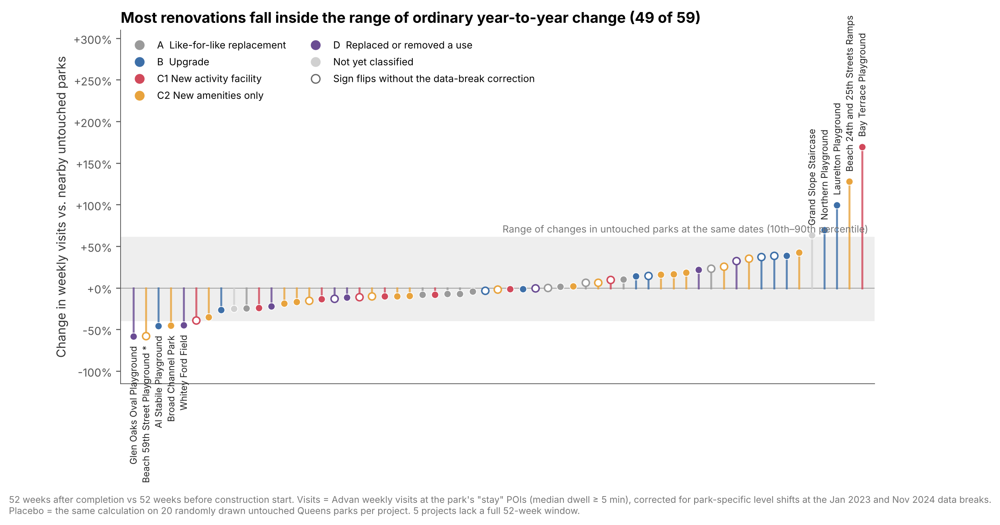
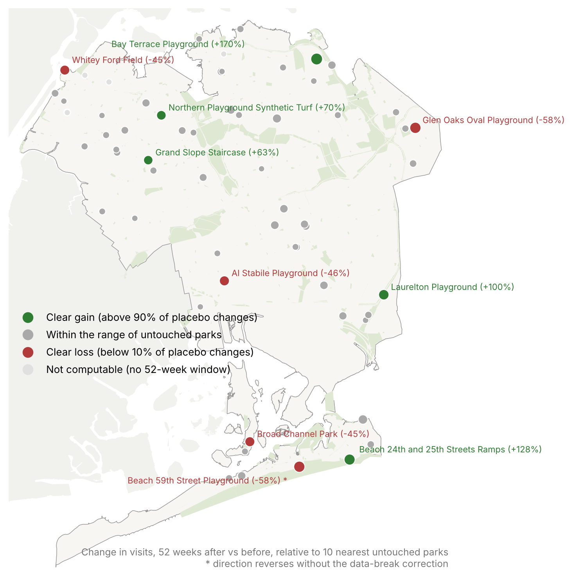

# Who Captures the Benefits of Park Renovation? Visitor Origins in New York City

*M.L.A. thesis, Cornell University. Work in progress: code and results here are preliminary.*

## Question

Cities spend heavily on renovating parks, and evaluations usually ask whether visits go up. This project asks **who the new visits come from**: how do the type, scale, and amenity content of a renovation change where visitors live, how they use the park, and whether nearby residents keep a share of the benefit?

## Design

- **Projects**: NYC Parks Capital Project Tracker, coded by type, scale, and amenity change from NYC Parks records and satellite imagery. Queens is the first study area; a citywide pass runs alongside it.
- **Visits**: Advan weekly patterns 2019–2026 for NYC park POIs, keeping "stay" POIs (median dwell ≥ 5 min, the same visit rule as the [LPUR paper](https://github.com/tianyewu-research/nyc-park-visitation-reach)).
- **Comparison**: each renovated park vs. its 10 nearest untouched parks, 52 weeks after completion vs. 52 weeks before construction start, with a placebo band from untouched parks at the same dates.
- **Visitor origins**: share of visitors living within 500 m / 1 km of the park edge, and visitor-weighted home distance.

 <em>Change in visits by project, with placebo band (preliminary)</em>

 <em>Queens projects with visit gains and losses (preliminary)</em>

## Code

| Folder | What it does |
|---|---|
| `src/fetch_*.py` | Download Advan (Dewey API), ACS (Census API), and 2010/2020 census geography. API keys are read from environment variables. |
| `src/lib_advan.py`, `src/util_week_list.py` | Shared Advan loader and week lists |
| `src/gate_*.py` | Feasibility diagnostics: observable closures, administrative-date lag, panel inflation, data QA |
| `src/atlas/` | Citywide green-space and renovation atlas (rounds 1–4): source audit, layer acquisition, governance/ownership, site status, maps, GeoPackage |
| `src/sample/` | Case inventory: sample rules, Queens screening, renovation coding, imagery and NYC Parks website verification |
| `src/case_studies/` | Early case-study boards and the Silver Lake Park weekly visitor-origin animation |
| `src/wed/` | Extract Queens and citywide park POI-week visits and visitor-origin aggregates |
| `analysis/2026-11_queens_citywide/` | Queens and citywide before/after comparisons with nearest untouched parks, origin change, within-park checks, figures |

## Caveats

Shifts in visitor origins are not evidence of displacement. Mobility data do not identify individuals. Renovation effects may be confounded with COVID-19 recovery, concurrent projects, and breaks in the Advan panel (January 2023, November 2024), which the analysis corrects for or avoids.

## Data

No data are included. Advan data are licensed (academic access via Dewey); all other sources (NYC Parks Capital Project Tracker, NYC Parks Properties, ACS, TIGER/Line) are public.

## Status

- [x] Citywide renovation atlas and inventory
- [x] Queens sample screening and renovation coding
- [x] Silver Lake Park prototype (weekly origin animation)
- [x] First-pass Queens and citywide comparisons
- [ ] Paired case studies by renovation type
