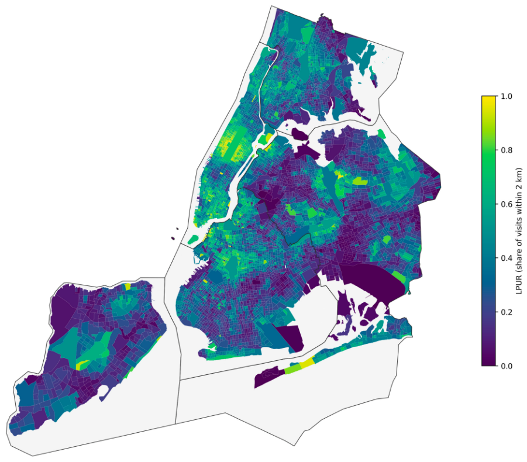
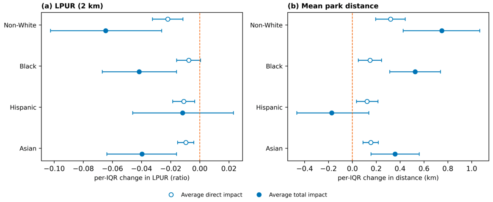
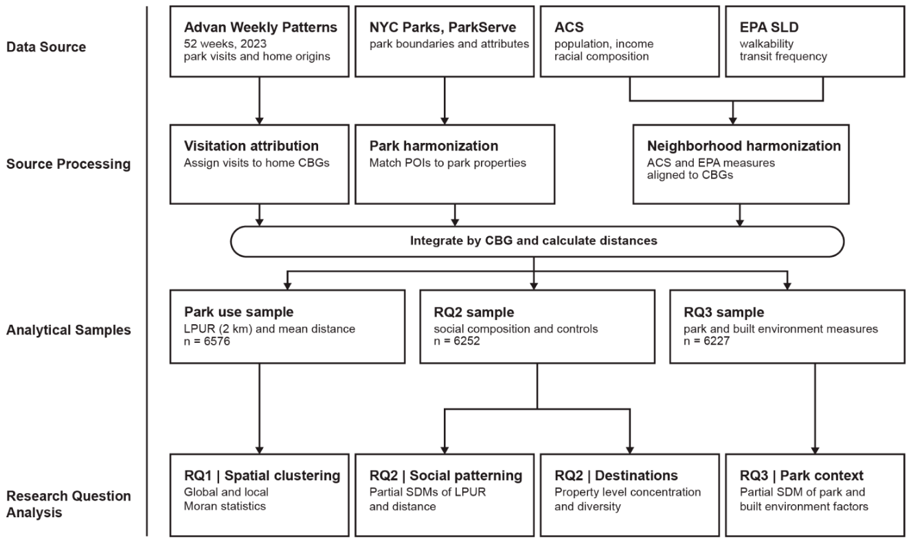

# Neighborhood Socio-Racial Composition and the Spatial Reach of Park Visitation in New York City

Code for: Wu, T., Kong, J., & Shen, X. (2026). *Land*, 15(10), 1818. https://doi.org/10.3390/land15101818

## Question

Having a park nearby does not mean residents use it. Using mobility data, this project asks **whether residents of predominantly non-White neighborhoods direct a smaller share of their park visits to nearby parks, and travel farther to the parks they do use**, after accounting for park supply and spatial spillovers between neighborhoods.

## Key findings

- **Local park-use ratio (LPUR)**, the share of dwell-qualified park visits from a census block group that go to parks within 2 km, is strongly spatially clustered (global Moran's I = 0.718).
- Higher non-White share is associated with lower LPUR and longer mean home-to-park distance. The association is larger once spatial spillovers are counted (total impact) than the direct effect alone.
- The association holds across 0.5–3 km radii, alternative spatial weights (kNN-6), network distance, and destination-concentration (HHI) checks.

<p align="center"><br><em>LPUR by census block group</em></p>

<p align="center"><br><em>Direct and total impacts from the spatial Durbin model (per-IQR change)</em></p>

## Data

| Source | Use | Included here? |
|---|---|---|
| Advan (2023) mobility patterns | Park visits by home census block group; dwell ≥ 5 min | ❌ Licensed. Code only |
| ACS 5-year estimates | Race/ethnicity, income, controls | Download script |
| NYC Parks inventory / ParkServe | Park polygons and POI matching | Download script |
| Built environment | Density, transit, walkability controls | Download script |

See `data/README.md` for how to obtain each dataset.

## Methods / workflow

<p align="center"></p>

1. **Visits**: match Advan POIs to park polygons; keep visitors with dwell ≥ 5 min (84% of raw visits are shorter pass-throughs).
2. **LPUR**: share of each block group's park visits reaching parks within 2 km.
3. **Accessibility control**: E2SFCA with a 6 km Gaussian catchment (σ = 3 km).
4. **Spatial diagnostics**: Queen contiguity; global Moran's I; LISA clusters with Benjamini–Hochberg FDR correction.
5. **Model selection**: OLS residuals strongly autocorrelated (I = 0.608); robust LM tests favor a lag structure (LM-lag 229.0 vs. LM-error 23.1) → **partial spatial Durbin model**, reported as direct, indirect, and total impacts.
6. **Robustness**: radius 0.5–3 km, kNN-6 weights, network distance, destination concentration (HHI).

## Repository structure

```
src/
  01_clean_mobility.py      # POI–park matching, dwell filter
  02_build_lpur.py          # LPUR + mean visit distance per CBG
  03_e2sfca.py              # accessibility control
  04_spatial_diagnostics.py # Moran's I, LISA + FDR
  05_sdm.py                 # spatial Durbin model, impacts
  06_robustness.py
notebooks/                  # figure reproduction
figures/
data/README.md              # data access instructions (no raw data)
```

## Reproduce

```bash
pip install -r requirements.txt
python src/01_clean_mobility.py   # requires licensed Advan data in data/raw/
...
```

## Citation

```bibtex
@article{wu2026park,
  title   = {Neighborhood Socio-Racial Composition and the Spatial Reach of Park Visitation in New York City},
  author  = {Wu, Tianye and Kong, Jie and Shen, Xiwei},
  journal = {Land},
  volume  = {15}, number = {10}, pages = {1818}, year = {2026},
  doi     = {10.3390/land15101818}
}
```
